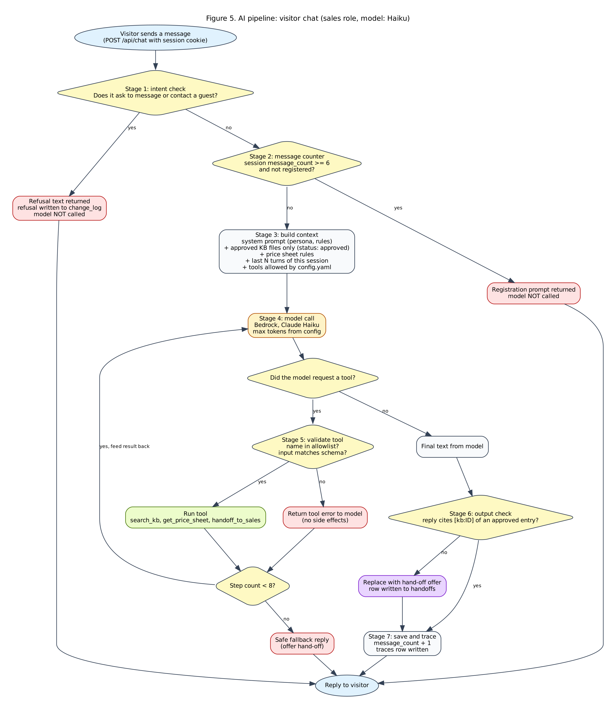
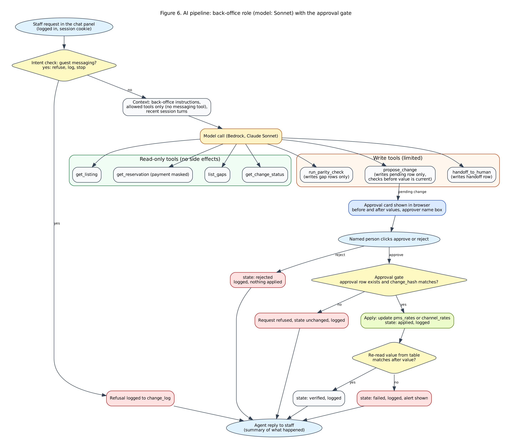

# AI Pipeline

Source: [Rental_Agent_Prototype_Architecture.pdf](source/Rental_Agent_Prototype_Architecture.pdf), section 3, Figures 5 and 6.

The prototype runs two roles on the same runtime. Each role has its own model, its own tool list and its own guardrails. The checks that decide whether something is allowed run in code, before and after the model. The model only decides what to say and which allowed tool to request.

## 1. Model roles

| Role | Used for | Model (set in `config.yaml`) | Tools |
|------|----------|------------------------------|-------|
| Visitor chat (sales) | Website visitors, KB answers, price questions, hand-off | Claude Haiku, from the Bedrock console | `search_kb`, `get_price_sheet`, `handoff_to_sales` |
| Back-office | Staff questions, parity checks, proposed rate changes | Claude Sonnet, from the Bedrock console | `get_listing`, `get_reservation`, `run_parity_check`, `list_gaps`, `propose_change`, `get_change_status`, `handoff_to_human` |

Model IDs are not written in the PDF or in these docs. Copy the exact ID and region from the Bedrock console once model access is enabled, and put them in `config.yaml` in place of the `<bedrock-model-id>` and `<aws-region>` placeholders.

[ASSUMPTION: the model choice may change after testing.] (A-01)

Tool details: [TOOLS.md](TOOLS.md).

## 2. Visitor chat pipeline (sales role, model: Haiku)

*Figure 5. Stages 1 and 2 run before the model is called, so refusals and the registration prompt cost nothing and cannot be talked around. Stage 6 replaces any answer without an approved citation with a hand-off offer.*

Entry: visitor sends a message (`POST /api/chat` with session cookie).

### Guardrail stages, in exact order

| Order | Stage | Check or action | If triggered | Model called? |
|-------|-------|-----------------|--------------|---------------|
| 1 | Stage 1: intent check | Does it ask to message or contact a guest? | Refusal text returned; refusal written to `change_log` | No |
| 2 | Stage 2: message counter | Session `message_count >= 6` and not registered? (see PA-01) | Registration prompt returned | No |
| 3 | Stage 3: build context | System prompt (persona, rules) + approved KB files only (status: approved) + price sheet rules + last N turns of this session + tools allowed by `config.yaml` | — | — |
| 4 | Stage 4: model call | Bedrock, Claude Haiku, max tokens from config | — | Yes |
| 5 | Stage 5: validate tool | Tool name in allowlist? Input matches schema? | No: return tool error to model (no side effects). Yes: run tool (`search_kb`, `get_price_sheet`, `handoff_to_sales`) | — |
| — | Step limit | Step count < 8? | Yes: feed result back to stage 4. No: safe fallback reply (offer hand-off) | — |
| 6 | Stage 6: output check | Reply cites `[kb:ID]` of an approved entry? | No: replace with hand-off offer; row written to `handoffs` | — |
| 7 | Stage 7: save and trace | `message_count + 1`; `traces` row written | — | — |

Stage 4 uses prompt caching when `prompt_caching: true` in `config.yaml` (D-14 in `CLAUDE_CHANGELOG.md`). The system prompt, which includes the approved KB, is cached with an explicit breakpoint, and the growing conversation is cached automatically. Later calls in the same turn, and turns within about 5 minutes, read the prefix from the cache.

Stages 4 and 5 repeat while the model requests tools. When the model returns final text (no tool request), the flow goes to stage 6. All paths end at "Reply to visitor".

Open points: N in "last N turns" (A-08), max tokens key (A-09, SR-01), how price-sheet answers satisfy stage 6 (A-17).

## 3. Back-office pipeline (model: Sonnet) with the approval gate

*Figure 6. Read tools have no side effects. Write tools only create pending rows or gap rows. Only the approval gate can lead to a rate change, and the change is verified by reading it back.*

Entry: staff request in the chat panel (logged in, session cookie).

### Stages, in exact order

| Order | Step | Detail |
|-------|------|--------|
| 1 | Intent check | Guest messaging? Yes: refuse, log (refusal logged to `change_log`), stop. |
| 2 | Context | Back-office instructions, allowed tools only (no messaging tool), recent session turns. |
| 3 | Model call | Bedrock, Claude Sonnet. |
| 4 | Tools | Read-only tools (no side effects): `get_listing`, `get_reservation` (payment masked), `list_gaps`, `get_change_status`. Write tools (limited): `run_parity_check` (writes gap rows only), `propose_change` (writes pending row only, checks before value is current), `handoff_to_human` (writes handoff row). |
| 5 | Approval card | Pending change shown in browser: before and after values, approver name box. |
| 6 | Human decision | Named person clicks approve or reject. Reject: state `rejected`, logged, nothing applied. |
| 7 | Approval gate | Approval row exists and `change_hash` matches? No: request refused, state unchanged, logged. |
| 8 | Apply | Update `pms_rates` or `channel_rates`; state `applied`, logged. |
| 9 | Verify | Re-read value from table matches after value? Yes: state `verified`, logged. No: state `failed`, logged, alert shown. |
| 10 | Reply | Agent reply to staff (summary of what happened). |

The tool allowlist and schema check (stage 5 of the visitor pipeline) and the 8-call step limit apply to this role too (agent loop rules, below). See PA-04 on `handoff_to_human` and the Fig. 6 caption, and A-18 on whether the citation check applies here.

The change lifecycle is detailed in [DATA_FLOWS.md](DATA_FLOWS.md#2-change-lifecycle).

## 4. Agent loop rules (both roles)

From PDF section 3:

1. The loop stops after 8 model calls and returns a safe fallback reply.
2. A tool request that is not on the allowlist, or whose input does not match its schema, returns an error to the model and has no side effects.
3. Each turn writes one `traces` row: model ID, tools called, token counts and elapsed time.
4. The model never receives credentials, and the system prompt contains only approved content for the project.

## 5. Where this lives in code

From PDF section 6 and Figure 2:

| Concern | File |
|---------|------|
| Intent check, message counter, output citation check | `guardrails.py` |
| Model loop, step limit, trace writing | `agent.py` |
| Bedrock client wrapper, one `complete()` function | `model.py` |
| Tool schemas, implementations, allowlist per project | `tools.py` |

Order inside a chat turn (Fig. 2 numbered arrows): 1. checks before model (`main.py` → `guardrails.py`), 2. run turn (`main.py` → `agent.py`), 3. output check (`agent.py` → `guardrails.py`).

## 6. Related documents

- Security rules and trust boundaries: [SECURITY.md](SECURITY.md)
- Acceptance tests for these stages: [ACCEPTANCE_TESTS.md](ACCEPTANCE_TESTS.md)
