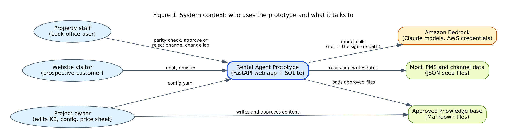
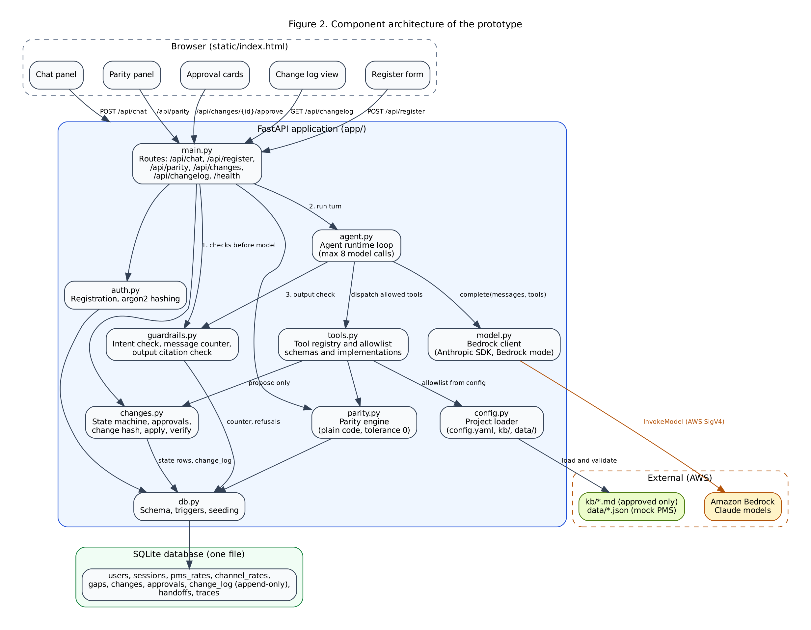
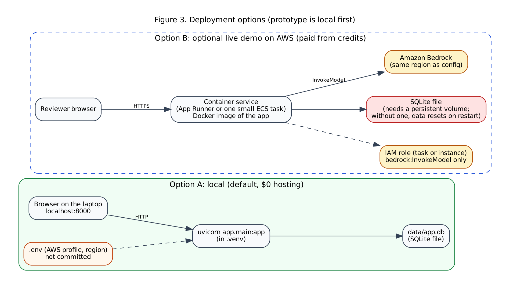
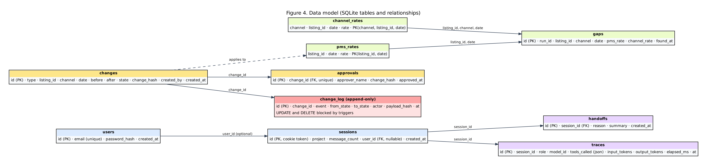

# Architecture

Source: [Rental_Agent_Prototype_Architecture.pdf](source/Rental_Agent_Prototype_Architecture.pdf), sections 2 and 6.

The service is one FastAPI process with one SQLite file. A browser page talks to it over HTTP. The process calls Amazon Bedrock for model responses and reads the project folder for content. Figure 1 shows who uses it, Figure 2 the internal components, Figure 3 where it can run, and Figure 4 the tables.

## 1. System context

*Figure 1. System context. Staff, visitors and the project owner interact with one application, which calls Bedrock and reads content and mock data files.*

| Actor or system | Interaction with the Rental Agent Prototype (FastAPI web app + SQLite) |
|-----------------|-------------------------------------------------------------------------|
| Property staff (back-office user) | Parity check, approve or reject change, change log |
| Website visitor (prospective customer) | Chat, register |
| Project owner (edits KB, config, price sheet) | Provides `config.yaml`; writes and approves content in the knowledge base |
| Amazon Bedrock (Claude models, AWS credentials) | Model calls (not in the sign-up path) |
| Mock PMS and channel data (JSON seed files) | Reads and writes rates |
| Approved knowledge base (Markdown files) | Loads approved files |

## 2. Component architecture

*Figure 2. Arrows show the request paths. Numbered arrows show the order inside a chat turn: (1) checks before model, (2) run turn, (3) output check.*

Browser panels in `static/index.html` and the routes they call (Fig. 2):

| Panel | Route |
|-------|-------|
| Chat panel | `POST /api/chat` |
| Parity panel | `/api/parity` |
| Approval cards | `/api/changes/{id}/approve` |
| Change log view | `GET /api/changelog` |
| Register form | `POST /api/register` |

### Component reference (PDF section 6)

| Component (file) | Responsibility | Inputs | Outputs | Depends on |
|------------------|----------------|--------|---------|------------|
| `main.py` | HTTP routes, request validation, session cookie | HTTP requests | JSON responses, HTML page | all modules |
| `config.py` | Loads project folder, validates `config.yaml`, KB and data files | `projects/<project>/` (see PA-07) | Project object | yaml, filesystem |
| `db.py` | Schema, triggers, seed data from `data/*.json` | config, JSON seeds | SQLite tables | sqlite3 |
| `guardrails.py` | Intent check, message counter, output citation check | visitor or staff text, session | allow, refuse or fallback decision | `db.py` |
| `agent.py` | Model loop, step limit, trace writing | messages, allowed tools | final reply | `model.py`, `tools.py`, `guardrails.py` |
| `model.py` | Bedrock client wrapper, one `complete()` function | messages, tool schemas, model ID | model response | anthropic SDK, AWS credentials |
| `tools.py` | Tool schemas and implementations, allowlist per project | tool name and input | tool result or error | `parity.py`, `changes.py`, `config.py` |
| `parity.py` | Compares PMS and channel rates, writes gaps | listing, date range | gaps list, run ID | `db.py` |
| `changes.py` | State machine, approvals, hashes, apply and verify, change log | proposals, approvals | change state | `db.py` |
| `auth.py` | Registration and password hashing | email, password | user row | `db.py`, argon2 |
| `static/index.html` | Chat, parity, approval cards, change log, register form | user actions | HTTP calls | `main.py` routes |

Additional labels from Figure 2:

- `agent.py`: agent runtime loop (max 8 model calls); calls `model.py` via `complete(messages, tools)`; dispatches allowed tools to `tools.py`.
- `model.py`: Bedrock client (Anthropic SDK, Bedrock mode); calls Amazon Bedrock with InvokeModel (AWS SigV4). **Amended (D-01, 2026-11-24):** the implementation uses the SDK's Mantle client (`AnthropicBedrockMantle`, endpoint `bedrock-mantle.{region}.api.aws`), still SigV4-signed; see [DECISIONS.md](DECISIONS.md#adr-06-amazon-bedrock-as-the-model-provider).
- `tools.py`: tool registry and allowlist; reaches `changes.py` for "propose only"; allowlist from config.
- `parity.py`: parity engine (plain code, tolerance 0).
- `config.py`: project loader (`config.yaml`, `kb/`, `data/`); loads and validates `kb/*.md` (approved only) and `data/*.json` (mock PMS).
- `guardrails.py`: counter and refusals stored through `db.py`.
- `changes.py`: state rows and `change_log` through `db.py`.

## 3. Deployment options

*Figure 3. Option A is the default. Option B only if a live link is needed. A container service without a persistent volume loses the SQLite data on restart, so it must use a volume or a different database before any shared demo.*

| | Option A: local (default, $0 hosting) | Option B: optional live demo on AWS (paid from credits) |
|-|---------------------------------------|----------------------------------------------------------|
| Client | Browser on the laptop, `localhost:8000`, HTTP | Reviewer browser, HTTPS |
| Runtime | `uvicorn app.main:app` (in `.venv`) | Container service (App Runner or one small ECS task), Docker image of the app |
| Database | `data/app.db` (SQLite file) | SQLite file (needs a persistent volume; without one, data resets on restart) |
| Credentials | `.env` (AWS profile, region), not committed | IAM role (task or instance), `bedrock:InvokeModel` only in the PDF; `bedrock-mantle:CreateInference` only after D-01 |
| Model | Amazon Bedrock | Amazon Bedrock (same region as config) |

[ASSUMPTION] Local development is the default. A hosted demo is optional and needs a persistent volume or another database. (A-05)

## 4. Data model

*Figure 4. The `change_log` table is append-only: triggers reject UPDATE and DELETE. Rates in `pms_rates` are changed only through the approval flow.*

| Table | Columns (Fig. 4) |
|-------|------------------|
| `users` | id (PK), email (unique), password_hash, created_at |
| `sessions` | id (PK, cookie token), project, message_count, user_id (FK, nullable), created_at |
| `pms_rates` | listing_id, date, rate; PK(listing_id, date) |
| `channel_rates` | channel, listing_id, date, rate; PK(channel, listing_id, date) |
| `gaps` | id (PK), run_id, listing_id, channel, date, pms_rate, channel_rate, found_at |
| `changes` | id (PK), type, listing_id, channel, date, before, after, state, change_hash, created_by, created_at |
| `approvals` | id (PK), change_id (FK, unique), approver_name, change_hash, approved_at |
| `change_log` (append-only) | id (PK), change_id, event, from_state, to_state, actor, payload_hash, at. UPDATE and DELETE blocked by triggers |
| `handoffs` | id (PK), session_id (FK), reason, summary, created_at |
| `traces` | id (PK), session_id, role, model_id, tools_called (json), input_tokens, output_tokens, elapsed_ms, at |

Relationships (Fig. 4):

- `users` → `sessions` via user_id (optional).
- `sessions` → `handoffs` and `traces` via session_id.
- `changes` → `approvals` via change_id; `changes` → `change_log` via change_id.
- `changes` applies to `pms_rates` (dashed: only through the approval flow).
- `pms_rates` → `gaps` via (listing_id, date); `channel_rates` → `gaps` via (listing_id, channel, date).

## 5. Project folder

From Fig. 2 and section 6, each project folder holds `config.yaml`, `kb/` (Markdown files, approved only are loaded) and `data/` (JSON seed files for the mock PMS and channels). In this repository the demo project is `projects/rental-demo/`.

## 6. Related documents

- AI pipeline and agent loop: [AI_PIPELINE.md](AI_PIPELINE.md)
- Data flows: [DATA_FLOWS.md](DATA_FLOWS.md)
- Trust boundaries: [SECURITY.md](SECURITY.md)
- Decisions behind this design: [DECISIONS.md](DECISIONS.md)
