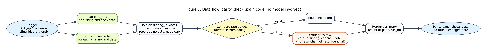
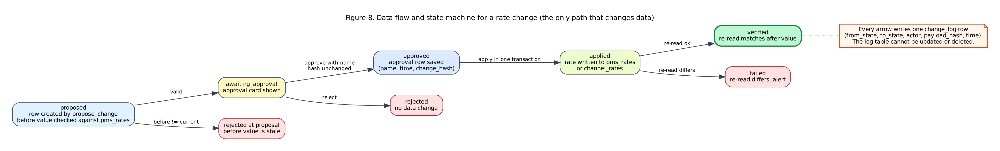
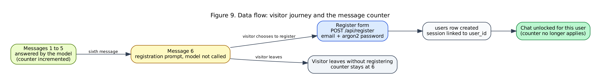

# Data Flows

Source: [Rental_Agent_Prototype_Architecture.pdf](source/Rental_Agent_Prototype_Architecture.pdf), section 4 (Figures 7 to 9) and section 9.

These three flows show how data moves for the three main operations that do not involve the model: the parity check, the lifecycle of a rate change, and the visitor's journey through the message limit.

## 1. Parity check



*Figure 7. Two reads, one join, one comparison. Missing values are reported as 'no data' and are not counted as gaps. Nothing is changed by this flow.*

Plain code, no model involved. Implemented by `parity.py`.

| Step | Action |
|------|--------|
| 1 | Trigger: `POST /api/parity/run` (listing_id, start, end). The `run_parity_check` tool runs the same flow. |
| 2a | Read `pms_rates` for the listing and each date. |
| 2b | Read `channel_rates` for each channel and date. |
| 3 | Join on (listing_id, date). Missing on either side: report as no data, not a gap. |
| 4 | Compare rate values; tolerance from config (0). |
| 5a | Equal: no record. |
| 5b | Different: write `gaps` row (run_id, listing, channel, date, pms_rate, channel_rate, found_at). |
| 6 | Return summary (count of gaps, run_id). |
| 7 | Parity panel shows gaps (no rate is changed here). |

Rules: a second run while one is active returns 409 run already active (PDF section 7). Acceptance test: AC-4.

## 2. Change lifecycle



*Figure 8. The state changes shown are the only way a rate changes. Each transition writes one `change_log` row.*

Implemented by `changes.py`. The back-office view of the same flow, including the approval card, is [Figure 6](source/diagrams/figure_06.png).

```
proposed ──valid──────────────▶ awaiting_approval ──approve with name, hash unchanged──▶ approved
   │                                   │                                                    │
   └─before != current─▶ rejected_at_proposal          └─reject─▶ rejected              apply in one transaction
                                                                                              ▼
                                                              verified ◀──re-read ok── applied ──re-read differs──▶ failed
```

| State | What happens | Data written |
|-------|--------------|--------------|
| `proposed` | Row created by `propose_change`; before value checked against `pms_rates` | `changes` row; `change_log` row |
| `rejected_at_proposal` | Before value is stale (before != current) | `change_log` row; no data change |
| `awaiting_approval` | Approval card shown | `change_log` row |
| `rejected` | Person rejected the change; no data change | `change_log` row |
| `approved` | Approval row saved (name, time, change_hash) | `approvals` row; `change_log` row |
| `applied` | Rate written to `pms_rates` or `channel_rates`, in one transaction with the state change | rate row; `change_log` row |
| `verified` | Re-read matches after value | `change_log` row |
| `failed` | Re-read differs; alert | `change_log` row |

Rules (PDF section 9):

- Approval is valid only for the exact change it was given for: the approval row stores the `change_hash`, and the approve endpoint recomputes the hash before accepting.
- Apply and the state change run in one database transaction. If the transaction fails, nothing is written.
- Each transition writes one `change_log` row containing the previous state, the new state, the actor, the payload hash and the time (`from_state`, `to_state`, `actor`, `payload_hash`, `at`).
- The log table cannot be updated or deleted.

Full state table: [FRD.md](FRD.md#10-change-state-table). Acceptance tests: AC-5, AC-7.

## 3. Visitor journey



*Figure 9. Messages one to five are answered. Message six is answered with a registration prompt. A visitor who registers gets unlimited chat for their account.*

| Step | Event | Data |
|------|-------|------|
| 1 | Messages 1 to 5 answered by the model | `sessions.message_count` incremented |
| 2 | Sixth message | Registration prompt; model not called |
| 3a | Visitor chooses to register: register form, `POST /api/register`, email + argon2 password | `users` row created; session linked to `user_id` |
| 3b | Chat unlocked for this user | Counter no longer applies |
| 4 | Visitor leaves without registering | Counter stays at 6 |

Known limit: clearing cookies starts a new visitor session, so the message limit can be reset this way. Accepted for the prototype (PDF section 11).

Counter timing differs between Figure 5 and Figure 9; see PA-01 in [ASSUMPTIONS.md](ASSUMPTIONS.md#pdf-ambiguities). Acceptance test: AC-3.
