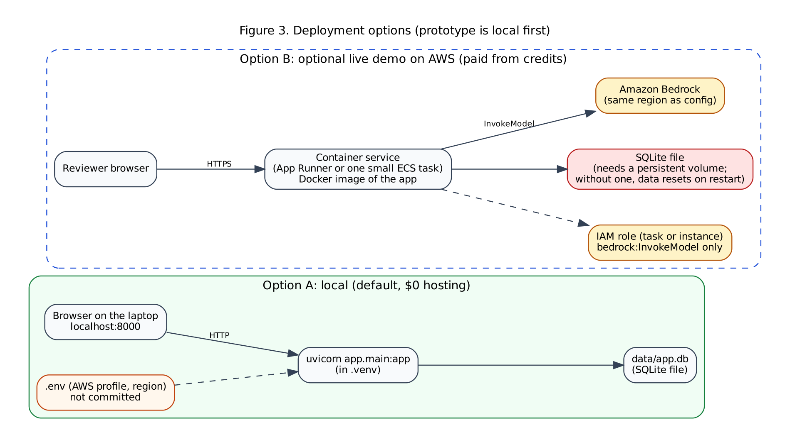

# Deployment: hosted demo on AWS (Option B)

Source: [Rental_Agent_Prototype_Architecture.pdf](source/Rental_Agent_Prototype_Architecture.pdf), Figure 3, Option B. Local development (Option A) stays the default; use this only when reviewers need a live link.

Owner decisions (2026-11-24, see `CLAUDE_CHANGELOG.md`): ECS Fargate with EFS; a Dockerfile plus this step-by-step guide (no infrastructure as code); no custom domain yet, so CloudFront's default `https://<id>.cloudfront.net` address is used; a public load balancer that only CloudFront can use.

**Current deployment (2026-11-26, decision D-20): one small EC2 server behind CloudFront.** It replaced the Fargate plan below to cut the running cost from about $45-50 a month to about $12 (about $4 while the server is stopped). The Fargate sections are kept as the alternative for when the demo needs automatic replacement or more capacity.

## EC2 host (current, D-20)

```
Reviewer browser ──HTTPS──▶ CloudFront (*.cloudfront.net, default certificate)
                                │  HTTP, port 80
                                ▼
                 EC2 t3.micro, Amazon Linux 2023, Elastic IP
                 · security group: inbound TCP 80 only from CloudFront's origin-facing prefix list; no SSH
                 · Docker runs the pinned image as a systemd service (restarts on failure and on reboot)
                 · /srv/rental-data on the encrypted root disk → /data in the container (SQLite /data/app.db)
                 · instance role: Bedrock InvokeModel on the two models, ECR pull, read the staff secret, SSM
                 · STAFF_PASSWORD read from Secrets Manager at each start into /run (memory only)
                                │
                                ▼
                 Amazon Bedrock (InvokeModel API), us-east-1
```

Trade-offs accepted for a demo:

- One server, no automatic replacement. If it fails, start it again or launch a new one from the same start-up script. The database lives on the server's disk, so terminating the server deletes it. Stopping it does not.
- The CloudFront-to-server leg is plain HTTP, as in the Fargate plan.
- The security group admits any CloudFront distribution, not only ours, because there's no load balancer to check D-17's secret header. Someone would need the server's address and their own distribution to reach it. A header check in the app would close this gap; it's not built.
- You patch the server: run `sudo dnf upgrade -y` and reboot now and then, or launch a fresh server from the latest Amazon Linux image.
- Shell access is through Systems Manager Session Manager only (no SSH key, no port 22).

Resources (names only; IDs stay out of git): ECR repository `rental_agent_prototype`; secret `rental-agent/staff-password`; security group `rental-ec2-sg`; IAM role and instance profile `rental-agent-ec2`; instance and Elastic IP tagged `Name=rental-agent`; one CloudFront distribution with the comment `rental-agent-prototype demo (EC2 origin)`.

### E.1 Image

Build and push from AWS CloudShell (it has Docker), tagging both `latest` and the short commit SHA:

```bash
git clone https://github.com/dunascode-prog/rental_agent_prototype.git && cd rental_agent_prototype
export REGION=us-east-1 ACCOUNT=$(aws sts get-caller-identity --query Account --output text)
export REGISTRY=$ACCOUNT.dkr.ecr.$REGION.amazonaws.com REPO=rental_agent_prototype TAG=$(git rev-parse --short HEAD)
aws ecr create-repository --repository-name $REPO --image-scanning-configuration scanOnPush=true   # first time only
docker build --pull -t $REPO:latest .
aws ecr get-login-password --region $REGION | docker login --username AWS --password-stdin $REGISTRY
docker tag $REPO:latest $REGISTRY/$REPO:latest && docker tag $REPO:latest $REGISTRY/$REPO:$TAG
docker push $REGISTRY/$REPO:latest && docker push $REGISTRY/$REPO:$TAG
```

### E.2 Staff password

```bash
aws secretsmanager create-secret --name rental-agent/staff-password --secret-string "$(openssl rand -base64 18)"
```

Read it when you need to log in: `aws secretsmanager get-secret-value --secret-id rental-agent/staff-password --query SecretString --output text`.

### E.3 Instance role

Trust policy: `ec2.amazonaws.com`, limited with `aws:SourceAccount` to your account. Permissions:

- inline `bedrock-invoke`: the same Bedrock policy as the Fargate task role in 3.5 below, with the two inference-profile and two foundation-model ARNs;
- inline `staff-secret`: `secretsmanager:GetSecretValue` on the secret's ARN only;
- managed `AmazonEC2ContainerRegistryReadOnly` (pull the image) and `AmazonSSMManagedInstanceCore` (Session Manager and Run Command).

Create an instance profile with the same name and add the role to it.

### E.4 Security group

`rental-ec2-sg` in the default VPC: inbound TCP 80 from the managed prefix list `com.amazonaws.global.cloudfront.origin-facing`; default outbound rule. Nothing else inbound.

### E.5 Server

1. Copy [`deploy/ec2-userdata.sh`](../deploy/ec2-userdata.sh), replace `__ACCOUNT__` with the account ID and set the image tag in `IMAGE`.
2. Launch:

```bash
aws ec2 run-instances --image-id <al2023-x86_64-ami> --instance-type t3.micro \
  --subnet-id <public-subnet> --security-group-ids <rental-ec2-sg-id> \
  --iam-instance-profile Name=rental-agent-ec2 \
  --metadata-options HttpTokens=required,HttpPutResponseHopLimit=2,HttpEndpoint=enabled \
  --block-device-mappings 'DeviceName=/dev/xvda,Ebs={VolumeSize=8,VolumeType=gp3,Encrypted=true,DeleteOnTermination=true}' \
  --credit-specification CpuCredits=standard \
  --user-data file://ec2-userdata.sh \
  --tag-specifications 'ResourceType=instance,Tags=[{Key=Name,Value=rental-agent}]'
```

Get the AMI ID from the public parameter `/aws/service/ami-amazon-linux-latest/al2023-ami-kernel-default-x86_64`. Two settings matter:

- `HttpPutResponseHopLimit=2` lets the container reach the instance metadata service through Docker's network, so the app gets the role's credentials. With the default of 1, Bedrock calls fail with missing credentials.
- `CpuCredits=standard` keeps the t3.micro from billing for extra CPU.

3. Allocate an Elastic IP and associate it with the instance, so the server's public DNS name (CloudFront's origin) survives stop and start.
4. The first start takes about 3-5 minutes (Docker install and image pull). Check with Run Command or Session Manager: `curl -s http://127.0.0.1/health`.

On Windows Git Bash, set `MSYS_NO_PATHCONV=1` before AWS CLI commands that take paths such as `/rental-agent` or `/aws/service/...`, or Git Bash rewrites them into Windows paths.

### E.6 CloudFront

Same settings as 3.9 below, with the origin set to the Elastic IP's public DNS name (`ec2-<ip>.compute-1.amazonaws.com`), HTTP only, port 80, no custom header. Price class 100 is enough for a demo.

### E.7 Check it works

- `https://<id>.cloudfront.net/health` returns `{"status":"ok"}`; `http://` redirects to `https://`.
- The server's address directly times out (security group).
- A visitor question such as "What time is check-in?" returns an answer with `[kb:check-in]`.
- Staff login with the secret's password works, and a back-office parity check for L-100, 2026-12-01 to 2026-12-07, reports the seeded 2026-12-05 gap.

All four passed on 2026-11-26.

### E.8 Updating, pausing and tearing down

- **Update:** push a new image tag, edit `IMAGE` in `/etc/rental-agent.conf` on the server (Session Manager), then `sudo systemctl restart rental-agent`. Data in `/srv/rental-data` is kept.
- **Pause:** `aws ec2 stop-instances --instance-ids <id>`. You keep paying for the disk and the Elastic IP (about $4 a month). Start it again with `start-instances`.
- **Tear down:**
  1. Disable and delete the CloudFront distribution.
  2. Terminate the instance, then release the Elastic IP.
  3. Delete the security group, the role (detach and delete its policies first) and the instance profile.
  4. Delete the secret and the ECR repository.

## Alternative: ECS Fargate (not deployed)

The sections below are the original Option B plan (decisions D-16 and D-17). They were partly built on 2026-11-26 and then removed when D-20 chose the EC2 host. Use them if the demo needs a managed, self-replacing service.



## 1. What gets built

```
Reviewer browser ──HTTPS──▶ CloudFront (*.cloudfront.net)
                                │  HTTP + secret header X-Origin-Verify
                                ▼
                 Application Load Balancer (public subnets)
                 · security group: inbound only from CloudFront's origin-facing IP list
                 · listener rule: forward only if X-Origin-Verify matches, else 403
                                │
                                ▼
                 ECS Fargate service, exactly 1 task (public subnet, public IP for outbound)
                 · container rental-agent-prototype, port 8000, user uid 1000
                 · /data ← EFS access point (SQLite file /data/app.db)
                 · task role: bedrock:InvokeModel on the two models only
                 · STAFF_PASSWORD from Secrets Manager
                                │
                                ▼
                 Amazon Bedrock (InvokeModel API), region from AWS_REGION
```

Trade-offs you accepted for a demo:

- The CloudFront-to-load-balancer leg is plain HTTP over the internet. The browser-to-CloudFront leg is HTTPS. The secret header and the CloudFront-only security group stop people bypassing CloudFront, but they don't encrypt that leg. Move to an HTTPS listener once you have a domain and a certificate.
- **Exactly one task.** SQLite on EFS is safe here only with a single writer. Keep the desired count at 1, and set the deployment to minimum healthy 0% and maximum 100%, so two tasks never write the database at once. A deploy therefore has a short downtime.

## 2. Prerequisites

- An AWS account and a region where the Claude models are enabled in Bedrock (assumption A-06).
- The AWS CLI v2, signed in with an admin-level profile for the setup.
- Docker on the machine that builds the image. CI also builds it on every PR (the `docker` check).
- The two Bedrock model or inference-profile IDs (for example `us.anthropic.<model-name>-v1:0`). They go into the task definition as `BEDROCK_MODEL_CHAT` and `BEDROCK_MODEL_BACKOFFICE`, so they stay out of git.

Placeholders used below: `<region>`, `<account-id>`, `<vpc-id>`, `<public-subnet-a>`, `<public-subnet-b>`, `<model-chat>`, `<model-backoffice>`, `<base-model-chat>`, `<base-model-backoffice>`, `<secret-arn>`, `<origin-secret>`. Never commit real values.

## 3. Steps

### 3.1 Push the image to ECR

```bash
# The deployed repository is named rental_agent_prototype; any valid name works if used consistently.
aws ecr create-repository --repository-name rental-agent-prototype --region <region>
aws ecr get-login-password --region <region> | docker login --username AWS --password-stdin <account-id>.dkr.ecr.<region>.amazonaws.com
docker build -t rental-agent-prototype .
docker tag rental-agent-prototype:latest <account-id>.dkr.ecr.<region>.amazonaws.com/rental-agent-prototype:latest
docker push <account-id>.dkr.ecr.<region>.amazonaws.com/rental-agent-prototype:latest
```

### 3.2 Store the staff password

Create a Secrets Manager secret holding only the staff password (plain text), for example `rental-agent/staff-password`. Note its ARN as `<secret-arn>`.

### 3.3 Security groups

| Group | Inbound | Purpose |
|-------|---------|---------|
| `alb-sg` | TCP 80 from the managed prefix list `com.amazonaws.global.cloudfront.origin-facing` | Only CloudFront can reach the load balancer |
| `task-sg` | TCP 8000 from `alb-sg` | Only the load balancer can reach the app |
| `efs-sg` | NFS (TCP 2049) from `task-sg` | Only the task can mount EFS |

All three keep the default outbound rule. The task needs outbound HTTPS to reach Bedrock, ECR, Secrets Manager and CloudWatch Logs.

### 3.4 EFS file system and access point

1. Create an EFS file system in `<vpc-id>`, with mount targets in both public subnets using `efs-sg`.
2. Create an access point:
   - POSIX user: UID `1000`, GID `1000` (the container user).
   - Root directory path: `/rental-agent`, with creation permissions owner UID `1000`, owner GID `1000`, permissions `755`. EFS creates the directory only when all three are set.

Note the file system ID and the access point ID.

### 3.5 IAM roles

**Task execution role** (used by ECS to pull the image, write logs and read the secret): attach the AWS managed policy `AmazonECSTaskExecutionRolePolicy`, plus this inline policy. The AWS docs say to add the Secrets Manager permission yourself.

```json
{
  "Version": "2012-10-17",
  "Statement": [
    { "Effect": "Allow", "Action": "secretsmanager:GetSecretValue", "Resource": "<secret-arn>" }
  ]
}
```

**Task role** (used by the app; the only AWS permission the code needs):

```json
{
  "Version": "2012-10-17",
  "Statement": [
    {
      "Effect": "Allow",
      "Action": ["bedrock:InvokeModel", "bedrock:InvokeModelWithResponseStream"],
      "Resource": [
        "arn:aws:bedrock:*:<account-id>:inference-profile/<model-chat>",
        "arn:aws:bedrock:*:<account-id>:inference-profile/<model-backoffice>",
        "arn:aws:bedrock:*::foundation-model/<base-model-chat>",
        "arn:aws:bedrock:*::foundation-model/<base-model-backoffice>"
      ]
    }
  ]
}
```

`<model-chat>` and `<model-backoffice>` are the inference-profile IDs the app calls (for example `us.anthropic.<model-name>-v1:0`); `<base-model-...>` are the same IDs without the `us.` prefix. A cross-region inference profile can route a call to another region in its geography, so the foundation-model ARNs use `*` for the region. If a model is called by its base ID with no profile, only its foundation-model line is needed (decision D-19). No AWS keys go into the container: the SDK picks up the task role automatically.

### 3.6 Task definition

Fargate, platform version `LATEST` (EFS needs 1.4.0 or later), 0.5 vCPU and 1 GB memory to start with.

```json
{
  "family": "rental-agent-prototype",
  "requiresCompatibilities": ["FARGATE"],
  "networkMode": "awsvpc",
  "cpu": "512",
  "memory": "1024",
  "executionRoleArn": "arn:aws:iam::<account-id>:role/<task-execution-role>",
  "taskRoleArn": "arn:aws:iam::<account-id>:role/<task-role>",
  "containerDefinitions": [
    {
      "name": "app",
      "image": "<account-id>.dkr.ecr.<region>.amazonaws.com/rental-agent-prototype:latest",
      "essential": true,
      "portMappings": [{ "containerPort": 8000, "protocol": "tcp" }],
      "environment": [
        { "name": "AWS_REGION", "value": "<region>" },
        { "name": "BEDROCK_MODEL_CHAT", "value": "<model-chat>" },
        { "name": "BEDROCK_MODEL_BACKOFFICE", "value": "<model-backoffice>" },
        { "name": "PROJECT_NAME", "value": "rental-demo" },
        { "name": "DATABASE_PATH", "value": "/data/app.db" },
        { "name": "SESSION_COOKIE_SECURE", "value": "1" }
      ],
      "secrets": [{ "name": "STAFF_PASSWORD", "valueFrom": "<secret-arn>" }],
      "mountPoints": [{ "sourceVolume": "data", "containerPath": "/data" }],
      "logConfiguration": {
        "logDriver": "awslogs",
        "options": {
          "awslogs-group": "/ecs/rental-agent-prototype",
          "awslogs-region": "<region>",
          "awslogs-stream-prefix": "app",
          "awslogs-create-group": "true"
        }
      }
    }
  ],
  "volumes": [
    {
      "name": "data",
      "efsVolumeConfiguration": {
        "fileSystemId": "<efs-id>",
        "transitEncryption": "ENABLED",
        "authorizationConfig": { "accessPointId": "<access-point-id>", "iam": "DISABLED" }
      }
    }
  ]
}
```

`awslogs-create-group` needs `logs:CreateLogGroup` on the execution role. Either create the log group yourself first, or add that permission.

### 3.7 Load balancer

1. Target group: type **IP**, protocol HTTP, port 8000, health check path `/health`.
2. Application Load Balancer: internet-facing, in both public subnets, security group `alb-sg`.
3. Listener HTTP:80:
   - **Default action:** fixed response 403.
   - **Rule:** if HTTP header `X-Origin-Verify` equals `<origin-secret>`, forward to the target group. Generate `<origin-secret>` as a long random string and keep it out of git.

### 3.8 ECS service

Cluster plus service with launch type Fargate:

- desired count **1**, deployment minimum healthy **0%**, maximum **100%**;
- subnets: the public subnets, **auto-assign public IP on** (for outbound calls; inbound is blocked by `task-sg`);
- security group `task-sg`, attached to the target group from 3.7.

Wait until the target shows healthy.

### 3.9 CloudFront distribution

- **Origin:** the load balancer's DNS name, protocol **HTTP only**, port 80, and the custom header `X-Origin-Verify: <origin-secret>`.
- **Default behavior:**
  - viewer protocol policy **Redirect HTTP to HTTPS**;
  - allowed methods **GET, HEAD, OPTIONS, PUT, POST, PATCH, DELETE** (needed for chat, login and approvals);
  - cache policy **CachingDisabled**;
  - origin request policy **AllViewer**, so cookies, headers and query strings reach the app.
- **Certificate:** the default CloudFront certificate (`*.cloudfront.net`).

Open `https://<id>.cloudfront.net` once the distribution is deployed.

## 4. Check it works

- `https://<id>.cloudfront.net/health` returns `{"status":"ok"}`.
- Calling the load balancer's DNS name directly returns 403: either it times out (security group) or you get the fixed 403 (no header).
- A visitor chat answers with a `[kb:...]` citation. If it falls back instead, check the model IDs, the region and the task role.
- Staff login works with the secret's password. Approvals, the parity panel and the change log work.
- Restart the task: the change log and registered users survive (EFS).

## 5. Updating and tearing down

- **Update:** push a new image, then "Force new deployment" on the service. With max 100%, the old task stops before the new one starts.
- **Tear down to stop costs:** delete the CloudFront distribution (disable it first), the ECS service and cluster, the load balancer and target group, the EFS file system, the secret, the ECR repository and the log group.

## 6. Not verified

- The Fargate steps were written from AWS and Anthropic documentation. They haven't been run end to end. Steps 3.2 to 3.6 were run on 2026-11-26 and then removed for D-20. The EC2 steps above have been run and checked. The image build and `/health` start-up are checked in CI.
- The IAM resources for cross-region inference profiles: if a call is denied, compare the ARN in the error message with the policy.
