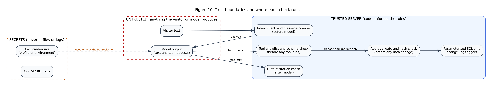

# Security

Source: [Rental_Agent_Prototype_Architecture.pdf](source/Rental_Agent_Prototype_Architecture.pdf), section 5 and Figure 10.

## 1. Trust boundaries

*Figure 10. Visitor text and model output are untrusted. Every rule that matters is enforced in server code, not in the prompt. AWS credentials are used only by the Bedrock client.*

| Zone | Contents | Rule |
|------|----------|------|
| SECRETS (never in files or logs) | AWS credentials (profile or environment); `APP_SECRET_KEY` | AWS credentials are used only by the Bedrock client |
| UNTRUSTED: anything the visitor or model produces | Visitor text; model output (text and tool requests) | Never trusted to enforce a rule |
| TRUSTED SERVER (code enforces the rules) | The checks listed below | All enforcement happens here |

### Where each check runs (Figure 10)

| Check | When | Guards |
|-------|------|--------|
| Intent check and message counter | Before model | Visitor text; only allowed text reaches the model |
| Tool allowlist and schema check | Before any tool runs | Tool requests from model output |
| Approval gate and hash check | Before any data change | Propose and approve only |
| Parameterised SQL only; `change_log` triggers | At the database | All writes |
| Output citation check | After model | Final text from the model |

## 2. Secrets handling

- Credentials and keys live in an AWS profile or environment variables, never in project files. The real `.env` file is excluded from version control (PDF section 5).
- Local: `.env` holds the AWS profile and region and is not committed (Fig. 3, Option A).
- Hosted: IAM role (task or instance) with `bedrock:InvokeModel` only (Fig. 3, Option B). **Amended (D-01, 2026-11-24):** the implementation calls the Bedrock Mantle endpoint, whose inference action is `bedrock-mantle:CreateInference`; grant that action only, scoped to the allowed model ARNs. The same applies to the local AWS profile.
- The Bedrock IAM permission is limited to model invocation.
- The model never receives credentials, and the system prompt contains only approved content for the project (PDF section 3).
- Model IDs, account numbers and keys are not written into these docs. Use placeholders such as `<bedrock-model-id>` and `<aws-region>`.
- [ASSUMPTION: the PDF lists `APP_SECRET_KEY` as a secret but does not state its use.] (A-13)

## 3. Security rules for the prototype

From PDF section 5:

1. Passwords are hashed with argon2 (or bcrypt if argon2 is not available). Passwords are never logged.
2. Credentials and keys live in an AWS profile or environment variables, never in project files. The real `.env` file is excluded from version control.
3. Payment details, where they appear in mock reservations, are masked to the last four digits in every output and log.
4. Database access uses parameterised queries only.
5. The `change_log` table is protected by database triggers, so the application cannot rewrite its own history.
6. The Bedrock IAM permission is limited to model invocation.

## 4. Guardrails enforced in code

From sections 1, 3 and 8 and Figures 5, 6:

- Guest messaging is refused before the model runs, and the refusal is logged. There is no messaging tool for either role.
- The registration prompt is returned before the model is called, so it cannot be talked around.
- Any answer without an approved citation is replaced with a hand-off offer.
- Only the approval gate can lead to a rate change, and the change is verified by reading it back.
- The agent loop stops after 8 model calls.

## 5. Known security limits (accepted for the prototype)

From PDF section 11:

- Clearing cookies starts a new visitor session, so the message limit can be reset this way.
- No email verification after registration.
- A single approver per project. No roles.

## 6. Related tests

- AC-6: guest-messaging request is refused and logged ([ACCEPTANCE_TESTS.md](ACCEPTANCE_TESTS.md)).
- AC-7: `change_log` rows cannot be updated or deleted.
